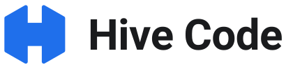
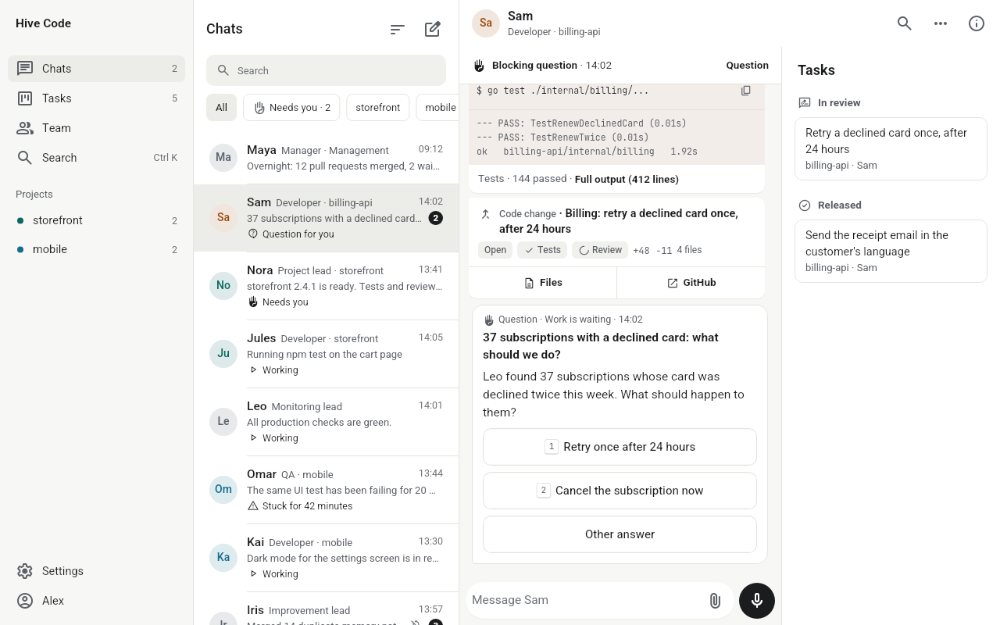
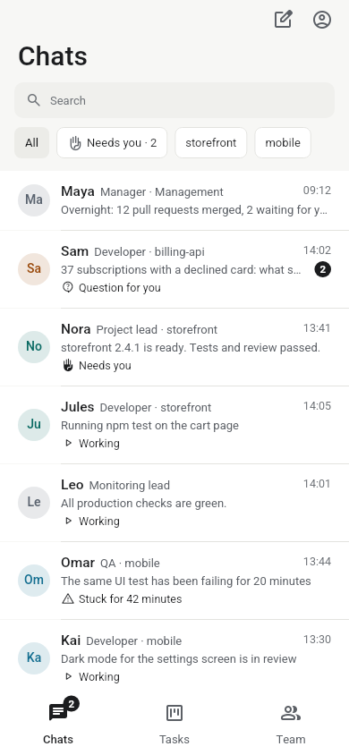
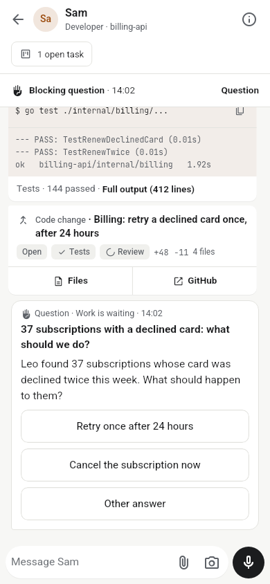

<p align="center">
  <picture>
    <source media="(prefers-color-scheme: dark)" srcset="docs/brand/hive-code/logo-dark.svg">
    
  </picture>
</p>

<div dir="rtl">

<p align="center"><strong>צוות של סוכני Claude Code שמנהלים מהטלפון.</strong></p>

<p align="center"><a href="https://github.com/hivecode-app/hive-code/actions/workflows/company-ci.yml"></a> <a href="https://github.com/hivecode-app/hive-code/releases/latest"></a> <a href="LICENSE"></a></p>

<p align="center">
  <a href="docs/install.md">התקנה</a> · <a href="docs/getting-started.md">צעדים ראשונים</a> · <a href="docs/architecture.md">איך זה עובד</a> · <a href="docs/faq.md">שאלות נפוצות</a> · <a href="README.md">English</a>
</p>

<picture>
  <source media="(prefers-color-scheme: dark)" srcset="docs/assets/screenshots/desktop-dark.png">
  
</picture>

Hive Code רץ על שרת לינוקס שלך והופך את Claude Code לחברה קטנה. מנהל מקבל את הבקשות שלך, פותח משימה לכל אחת ומעביר אותה לעובד. כל עובד הוא סשן אמיתי של Claude Code, עם שם, תפקיד וזיכרון שנשמר גם אחרי הפעלה מחדש. כל משימה נגמרת ב-PR שעובד אחר סוקר לפני המיזוג. את כל זה רואים באפליקציה אחת, והעבודה עוצרת בשבילך רק כשבאמת צריך אותך: שאלה, אישור להעלות לפרודקשן או כניסה לאתר.

## למי זה מיועד

למפתחים שכבר עובדים עם Claude Code ורוצים כמה סשנים שרצים במקביל, בלי לשבת מול טרמינל לכל אחד. צריך מנוי Claude Pro או Max, חשבון GitHub ושרת לינוקס בשליטתך.

<p align="center">
  
  &nbsp;&nbsp;
  
</p>

## התקנה

בשרת Ubuntu או Debian עם systemd, כמשתמש הרגיל שלך (לא root):

</div>

```sh
curl -fsSL https://raw.githubusercontent.com/hivecode-app/hive-code/main/scripts/install.sh | bash
```

<div dir="rtl">

ההתקנה בודקת את הדרישות, מבקשת ממך לאשר את הגישה של העובדים, מתקינה את Claude Code בגרסה ש-Hive Code נבדק איתה, מתחברת לחשבון Claude שלך ומדפיסה QR. סורקים אותו בטלפון, עוברים ארבעה שלבי הקמה קצרים באפליקציה, והמנהל כבר מחכה בשיחה שלו. אפשר להריץ אותה שוב בבטחה: כל שלב מדלג על מה שכבר קיים.

כדי לראות את כל השלבים בלי לשנות כלום, מריצים עם `--dry-run`. הדרישות, האפשרויות לכתובת ומה עושים כשמשהו נתקע נמצאים ב[מדריך ההתקנה](docs/install.md).

## איך זה עובד

- **שרת אחד, תהליך אחד.** `hq` שומר את המצב ב-SQLite, מעביר הודעות, מתזמן עבודה ומגיש את ה-API שהאפליקציה מדברת איתו. כל עובד רץ כתהליך `claude` משלו, בתוך תהליך קטן ששורד הפעלה מחדש של `hq`.
- **החברה שלך היא repo של git.** התפקידים, הכללים, האמנה של כל פרויקט והזיכרון המשותף הם קבצי Markdown ו-YAML רגילים ב-`~/company`. גם הם משתנים ב-PR, כמו קוד.
- **לכל משימה ענף ו-PR.** סוקר בלי כלי עריכה ובהקשר נקי עובר עליו, והוא מתמזג רק כשהסקירה אישרה וה-CI ירוק.
- **שום דבר לא עולה לפרודקשן בלעדיך.** פריסה מבקשת את האישור שלך, עם מה משתנה, מה הסיכון ואיך חוזרים אחורה.
- **העובדים זוכרים.** כשסשן נגמר, העובד כותב העברה, והמשמרת הבאה ממשיכה ממנה. החלטות ולקחים נכנסים לזיכרון משותף שכל העובדים קוראים.

התמונה המלאה: [ארכיטקטורה](docs/architecture.md) (באנגלית).

## אבטחה והרשאות

ב-Hive Code לעובדים יש גישה מלאה, בכוונה. הם מריצים את Claude Code ב-`bypassPermissions` על השרת שלך, עם החשבון שלך ב-GitHub, ויכולים להריץ פקודות, לשנות קבצים ולדחוף קוד. ההתקנה מבקשת ממך לאשר את זה לפני שהיא מתחילה. Hive Code אוכף שני גבולות עם hooks: עובד לא יכול לכתוב לתיקיות ש-Hive Code עצמו רץ מהן, ו-PR לא מתמזג בלי סקירה שאישרה אותו. כל השאר תלוי בהנחיות של העובד ובכללים שלך.

- הכול רץ על המכונה שלך, עם המנוי שלך ל-Claude. Hive Code לא שולח טלמטריה.
- `hq` מאזין רק ל-`127.0.0.1`. האפליקציה מגיעה אליו דרך הכתובת שבחרת: Tailscale Funnel, ‏Cloudflare Tunnel או דומיין משלך.
- טלפונים ודפדפנים מתחברים בקוד צימוד חד-פעמי או ב-passkey, ולכל מכשיר טוקן משלו.

מתקינים את זה על שרת שהיית נותן עליו גישה למפתח. לדיווח על פגיעות: [SECURITY.md](SECURITY.md).

## מצב הפרויקט

Hive Code בגישה מוקדמת (0.x). האפליקציה בעברית ובאנגלית. הפלט של ההתקנה, ההנחיות המובנות של העובדים וערכת הפתיחה של החברה כתובים היום בעברית, וגרסה באנגלית בדרך. לאנדרואיד יש אפליקציה, ובאייפון עובדים מהדפדפן. התראות פוש באנדרואיד עוד לא זמינות בהתקנה עצמאית, ולכן האפליקציה מקבלת עדכונים בחיבור הרגיל שלה כשהיא פתוחה. מה השתנה בכל גרסה: [CHANGELOG](CHANGELOG.md).

על השרת Hive Code עדיין משתמש בשם הפנימי שלו: הפקודה היא `company`, והקבצים, השירותים והחבילות נקראים `agent-company`.

## תרומה לפרויקט

דיווחי באגים ו-PR מתקבלים בשמחה. מתחילים ב-[CONTRIBUTING.md](CONTRIBUTING.md).

## רישיון

[MIT](LICENSE)

</div>
