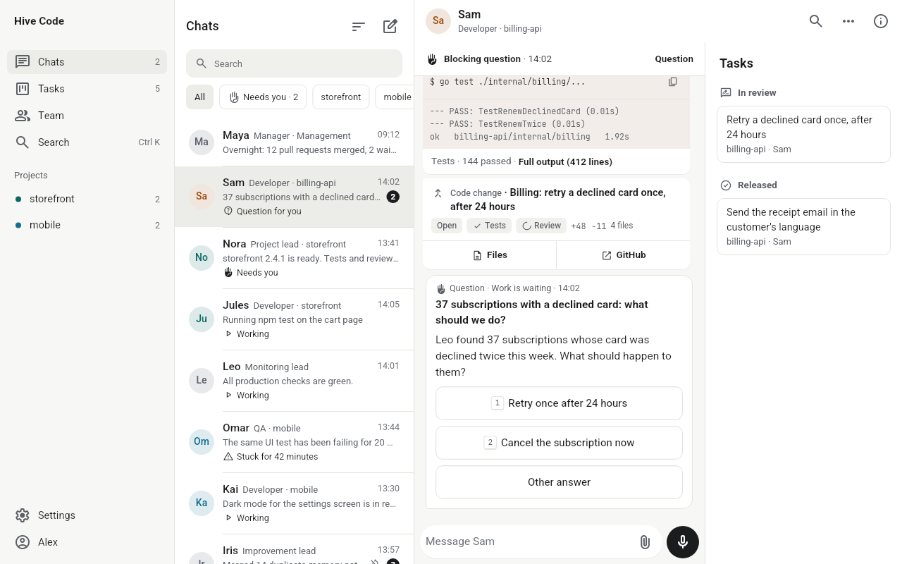
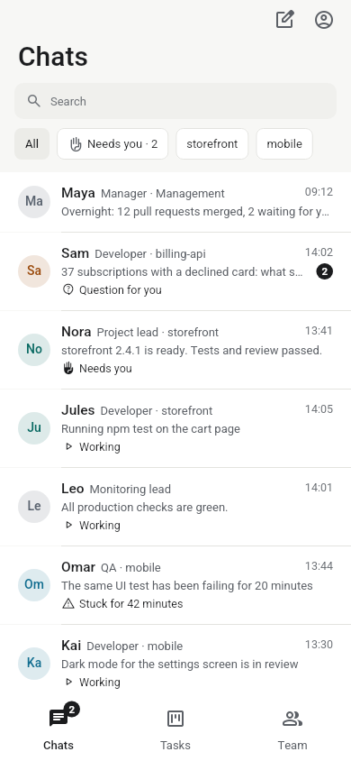
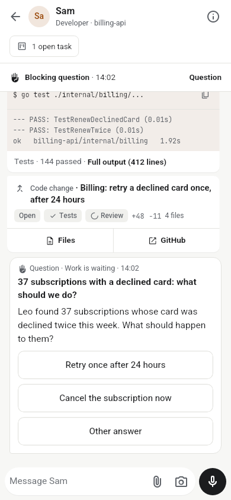

<p align="center">
  <picture>
    <source media="(prefers-color-scheme: dark)" srcset="docs/brand/hive-code/logo-dark.svg">
    
  </picture>
</p>

<p align="center"><strong>A team of Claude Code agents that you manage from your phone.</strong></p>

<p align="center">
  <a href="docs/install.md">Install</a> · <a href="docs/getting-started.md">Getting started</a> · <a href="docs/architecture.md">How it works</a> · <a href="docs/faq.md">FAQ</a> · <a href="README.he.md">עברית</a>
</p>

<picture>
  <source media="(prefers-color-scheme: dark)" srcset="docs/assets/screenshots/desktop-dark.png">
  
</picture>

Hive Code runs on your own Linux server and turns Claude Code into a small company. A manager takes your requests, opens a task for each one, and hands it to a worker. Every worker is a real Claude Code session with a name, a role and a memory that survives restarts. Each task ends as a pull request that another worker reviews before it merges. You follow all of it in one app, and the work only stops for you when it really needs you: a question, an approval to ship, or a login.

## Who it is for

Developers who already use Claude Code and want more of it running at once, without sitting in front of a terminal for each session. You need a Claude Pro or Max subscription, a GitHub account and a Linux server you control.

<p align="center">
  
  &nbsp;&nbsp;
  
</p>

## Install

On an Ubuntu or Debian server with systemd, as your regular user (not root):

```sh
curl -fsSL https://raw.githubusercontent.com/hivecode-app/hive-code/main/scripts/install.sh | bash
```

The installer checks the requirements, asks you to confirm the workers' access, installs Claude Code at the version Hive Code is tested with, signs in to your Claude account, and prints a QR code. Scan it with your phone, go through four short setup steps in the app, and the manager is waiting in its conversation. It is safe to run again: every step skips what is already in place.

To see every step without changing anything, run it with `--dry-run`. Requirements, address options and troubleshooting are in the [install guide](docs/install.md).

## How it works

- **One server, one process.** `hq` keeps the state in SQLite, delivers messages, schedules work and serves the API that the app talks to. Each worker runs as its own `claude` process under a small host that survives restarts of `hq`.
- **Your company is a git repository.** The roles, the rules, each project's charter and the shared memory are plain Markdown and YAML in `~/company`. Changes to them go through a pull request, like code.
- **Every task gets a branch and a pull request.** A reviewer with no edit tools and a clean context reviews it, and it merges only when the review approves and CI is green.
- **Nothing reaches production without you.** Deploying asks for your approval, with what changes, the risk and how to roll back.
- **Workers remember.** When a session ends, the worker writes a handoff and the next shift starts from it. Decisions and lessons go into shared memory that every worker reads.

The full picture is in [architecture](docs/architecture.md).

## Security and permissions

Hive Code gives the workers full access, on purpose. They run Claude Code with `bypassPermissions` on your server, with your GitHub login, and can run commands, change files and push code. The installer asks you to confirm this before it starts. Hive Code enforces two limits with hooks: a worker cannot write into the checkouts Hive Code itself runs from, and a pull request cannot merge without an approving review. Anything else a worker does is up to its instructions and your rules.

- Everything runs on your machine, with your Claude subscription. Hive Code sends no telemetry.
- `hq` listens on `127.0.0.1` only. The app reaches it through the address you choose: Tailscale Funnel, a Cloudflare Tunnel or your own domain.
- Phones and browsers sign in with a one-time pairing code or a passkey, and every device gets its own token.

Install it on a server you would trust a developer with. To report a vulnerability, see [SECURITY.md](SECURITY.md).

## Status

Hive Code is in early access (0.x). The app speaks English and Hebrew. The installer's output, the workers' built-in instructions and the starter company are written in Hebrew today, and English versions are on the way. Android has an app; on iPhone it runs in the browser. Push notifications on Android are not available yet for your own installation, so the app gets its updates over its regular connection while it is open. The [changelog](CHANGELOG.md) lists what changed in each version.

On the server, Hive Code still uses its internal name: the command is `company`, and the files, services and packages are named `agent-company`.

## Contributing

Bug reports and pull requests are welcome. Start with [CONTRIBUTING.md](CONTRIBUTING.md).

## License

[MIT](LICENSE)
