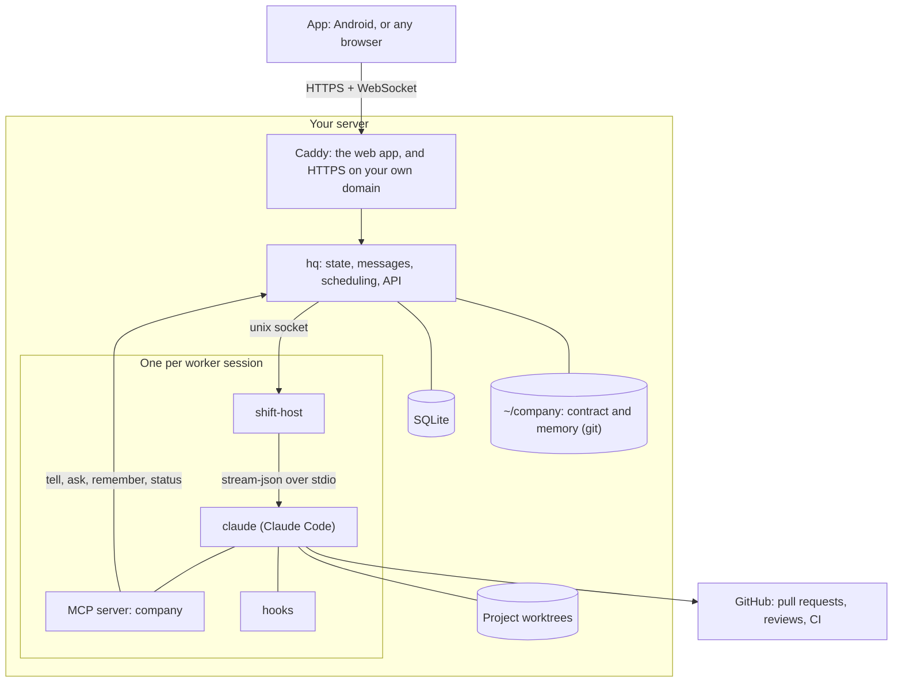

# Architecture

Hive Code is one long-running process (`hq`) plus one small process per worker session, on a Linux server you own. The company itself (roles, rules, memory) lives in a separate git repository that the workers read and change through pull requests.

## Components

| Package | What it does |
|---|---|
| `packages/hq` | The central process. Stores everything in SQLite (WAL), delivers messages between you and the workers, schedules tasks and shifts, watches for stuck or dead sessions, runs probes, and serves the API. It is a single process, so there are fewer moving parts. Caddy in front of it serves the web app and passes the API through. |
| `packages/shift-host` | A small process per worker session. It owns the `claude` process's stdin and stdout, writes every event to a durable log, and outlives restarts of `hq`. |
| `packages/adapter` | The only module that knows how Claude Code is started and how its output looks. When Claude Code changes, this is the one place that changes. `adapter/contract.yaml` lists every Claude Code behaviour we rely on, each with a canary check. |
| `packages/mcp-company` | The `company` MCP server that every worker gets. It is how a worker talks to you and to other workers (`tell`, `ask`), saves knowledge (`remember`, `recall`), reports progress (`status`) and asks for approval (`request_go`). |
| `packages/hooks` | Claude Code hooks. They keep workers out of the checkouts `hq` runs from, stop a merge that has no approving review, and write tool events to a spool that `hq` reads. |
| `packages/app` | The app, in Flutter, for Android and the web. |
| `packages/shared` | Types and helpers shared by the TypeScript packages. |
| `starter/` | The files a new company starts from: the contract (`company/`) and the memory (`memory/`). |
| `scripts/` | The installer, `company` CLI, release, update, backup and diagnostics. |

## The company repository

Your company is plain files in `~/company`, versioned with git:

- `company/company.md`: the principles and the default way every project works.
- `company/org.yaml`: teams, identities and automations. Anything that runs on its own is listed here and can be turned off.
- `company/identities/`: one file per permanent role, with its personality and responsibilities.
- `company/projects/`: one charter per project: the repository, the commands to install, test and build, the CI check that must pass, and any exceptions to the defaults.
- `company/skills/`: shared procedures, such as how to review a pull request and how to ship.
- `memory/`: decisions, lessons and facts that every worker can recall.

Workers change these files through pull requests, like code. The only exception is short running logs (what is open, what was done), which go in directly.

## A task, end to end

1. You write to the manager. The manager opens a task and picks a worker.
2. `hq` creates a branch and a git worktree for the task in the project's checkout, and starts a shift: a `shift-host` with a `claude` process inside it.
3. The worker works in its worktree, runs the project's tests and opens a pull request.
4. A reviewer session with no edit tools and a clean context reviews the pull request. One full review, fixes, and one narrow review of the fixes.
5. With an approving review and a green CI check, the worker merges. A hook refuses the merge otherwise.
6. Deploying to production waits for your GO.
7. The worker writes a handoff, reports the result, and the shift ends. `hq` keeps any uncommitted work and removes the worktree.

## Shifts and memory

A worker outlives its sessions. When a session ends (the task is done, the context is full, or the machine restarted), the worker writes a handoff, and the next shift starts from it together with the worker's file and the project's memory. `hq` notices sessions that stop responding and restarts them.

## More than one machine

Additional machines can join as worker hosts. They run shifts only; `hq` stays on the main server and sends them work over SSH.
